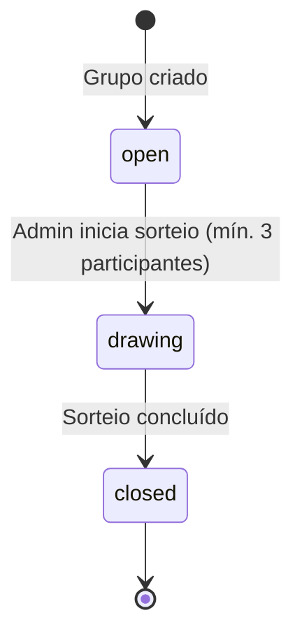
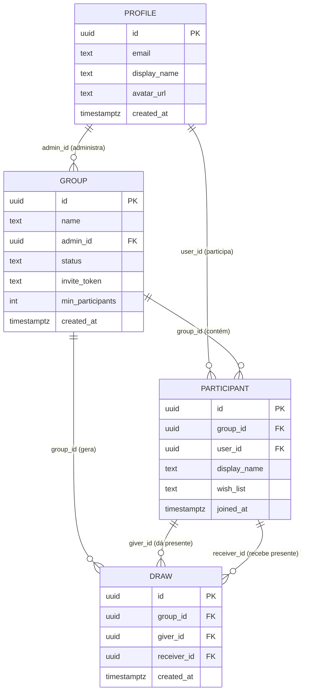

# UTF-Secret - Sistema de Amigo Secreto Online

Sorteio de amigo secreto em que a privacidade é garantida pelo banco de dados, não pela interface.

Projeto final da disciplina *Desenvolvimento de Aplicações Front-End com Frameworks e Componentes*.

## Visão e Core Value

O UTF-Secret resolve o problema de organizar sorteios de Amigo Secreto de forma manual, presencial e sem
privacidade: muitas vezes o organizador acaba sabendo quem tirou quem, ou o processo é burocrático e sujeito
a erros. O sistema permite que um administrador crie um grupo online, convide participantes por link e
realize o sorteio de forma automatizada e **completamente privada**.

**Core value:** o sorteio é privado *de verdade*. Cada participante lê apenas o próprio resultado, e isso é
imposto pelo banco via **RLS (Row Level Security)** do Supabase, não escondido na UI. A tabela `draw` tem uma
única política de leitura (`giver_id` pertence ao usuário logado), nenhuma política referencia o administrador
e não existe política de escrita para usuários autenticados. O único escritor é a Edge Function `run-draw`, que
usa a `service_role` key, a qual nunca chega ao navegador. **O administrador do grupo NÃO vê os pares sorteados.**

Objetivo: uma plataforma web simples, segura e mobile-first para gerenciar sorteios do cadastro ao resultado.

## Links

- **Produção (Vercel):** https://amigo-secreto-45wxm00ln-zmp2.vercel.app (URL por deployment sob o escopo
  `zmp2`; o alias `amigo-secreto.vercel.app` pertence a um app de terceiros e **não** é este projeto - ver
  [`docs/deploy.md`](docs/deploy.md))
- **Protótipo Figma:** _(link público a ser inserido - ver [`docs/prototype-brief.md`](docs/prototype-brief.md))_
- **Kanban (GitHub Projects):** https://github.com/users/pedrozampier/projects/3 (detalhes em [`docs/kanban.md`](docs/kanban.md))
- **Repositório:** https://github.com/pedrozampier/amigo-secreto

## Atores

| Ator | Descrição | Permissões |
|:-----|:----------|:-----------|
| **Administrador** | Cria o grupo e gerencia participantes | Criar grupo, compartilhar convite, remover participantes, iniciar sorteio |
| **Participante** | Membro do grupo | Entrar via convite, ver o próprio par sorteado, editar a lista de desejos |
| **Visitante** | Usuário não autenticado | Criar conta, fazer login (e então abrir um link de convite) |

## User Stories

As 11 histórias abaixo são as mesmas registradas como Issues no Kanban.

| # | Como... | Eu quero... |
|---|---------|-------------|
| US01 | visitante | criar uma conta com e-mail e senha |
| US02 | visitante | fazer login com minha conta |
| US03 | administrador | criar um grupo de Amigo Secreto |
| US04 | administrador | gerar um link de convite |
| US05 | administrador | visualizar a lista de participantes |
| US06 | administrador | remover um participante do grupo |
| US07 | administrador | encerrar as inscrições e iniciar o sorteio |
| US08 | participante | entrar em um grupo via link de convite |
| US09 | participante | ver quem eu tirei, de forma oculta |
| US10 | participante | cadastrar minha lista de desejos |
| US11 | participante | ver a lista de desejos de quem tirei |

Fora de escopo: SMS, login social, chat, restrições de pares, app nativo, controle de valor do presente e
histórico de sorteios (ver [`docs/prd.md`](docs/prd.md) §6).

## Regras de Negócio

1. Um grupo precisa de **no mínimo 3 participantes** para o sorteio ser realizado.
2. O sorteio é **irreversível**: depois de iniciado, não pode ser desfeito.
3. Ninguém é sorteado para si mesmo (garantido estruturalmente pelo pareamento circular).
4. O **administrador não tem acesso aos pares**: apenas cada participante vê o próprio resultado (**RLS** em `draw`).
5. Cada pessoa entra **uma única vez** em cada grupo. O convite é um link **único por grupo** e a unicidade vem
   da constraint `UNIQUE (group_id, user_id)` em `participant` (a redação original "único por e-mail" não era
   implementável com um único `invite_token` por grupo; a revisão está em [`docs/prd.md`](docs/prd.md) §5).
6. O sorteio só pode ser feito **uma única vez** por grupo (UPDATE condicional atômico + `UNIQUE (group_id, giver_id)`).
7. Depois do sorteio, **ninguém novo pode entrar**.
8. A lista de desejos é **opcional** e editável até o encerramento do grupo.

O status do grupo é uma máquina de estados: `open -> drawing -> closed`.



## Modelagem de Dados (Diagrama ER)



Este diagrama existe em dois lugares (aqui e em [`docs/sdd.md`](docs/sdd.md) §3.2) porque o RA8-ID29 exige a
modelagem ER no README. Ao alterar o schema, atualize os dois.

Entidades: `profile` (usuário), `group` (grupo), `participant` (participante) e `draw` (par sorteado). Atenção:
`draw.giver_id` e `draw.receiver_id` apontam para `participant.id`, não para `user_id`.

## Design System

Os tokens vivem em [`src/styles.css`](src/styles.css) (Tailwind CSS 4, configuração CSS-first, sem
`tailwind.config.js`) e vêm do preset do Spartan UI (HLM), customizados com uma paleta natalina sóbria: verde-pinho
como cor primária e dourado como acento, sem virar cartão de Natal.

### Tokens de cor

| Token | oklch (claro) | Hex | oklch (escuro) | Onde é usado |
|:------|:--------------|:----|:---------------|:-------------|
| `--primary` | `oklch(0.35 0.07 155)` | `#16452a` | `oklch(0.85 0.08 155)` (`#a4deb7`) | Botões primários (`hlmBtn`), `theme_color` do PWA |
| `--primary-foreground` | `oklch(0.985 0 0)` | `#fafafa` | `oklch(0.205 0 0)` (`#171717`) | Texto sobre `--primary` |
| `--ring` | `oklch(0.52 0.09 155)` | `#397852` | `oklch(0.62 0.1 155)` (`#50986b`) | Anel de foco visível (2px), contraste 5.27:1 no tema claro (WCAG 1.4.11) |
| `--accent-foreground` | `oklch(0.5 0.12 85)` | `#825c00` | `oklch(0.8 0.13 85)` (`#e4b750`) | Acento dourado, destaques natalinos |
| `--destructive` | `oklch(0.577 0.245 27.325)` | `#e7000b` | `oklch(0.704 0.191 22.216)` (`#ff6467`) | Mensagens de erro, ações destrutivas (confirmar sorteio, remover), 4.76:1 |
| `--muted-foreground` | `oklch(0.556 0 0)` | `#737373` | `oklch(0.708 0 0)` (`#a1a1a1`) | Textos secundários e descrições, 4.73:1 |
| `--border` / `--input` | `oklch(0.922 0 0)` | `#e5e5e5` | `oklch(1 0 0 / 10%)` / `oklch(1 0 0 / 15%)` | Bordas de card e de campo |
| `--background` | `oklch(1 0 0)` | `#ffffff` | `oklch(0.145 0 0)` (`#0a0a0a`) | Fundo da página |
| `--foreground` | `oklch(0.145 0 0)` | `#0a0a0a` | `oklch(0.985 0 0)` (`#fafafa`) | Texto principal, banner de offline |
| `--radius` | `0.625rem` | - | `0.625rem` | Raio de card, botão e campo |

Os valores hex foram obtidos por conversão a partir do oklch (e conferidos contra o `theme_color` do manifest).
Os contrastes citados e o método de cálculo ficam em [`docs/accessibility-audit.md`](docs/accessibility-audit.md).

**Tema escuro.** É entregue por `@media (prefers-color-scheme: dark)` em `styles.css`, seguindo a preferência do
sistema operacional. Não há toggle, nem signal, nem `localStorage`: a auditoria de contraste cobre os dois temas.

**Limitação registrada (sincronização manual).** O `manifest.webmanifest` e o `<meta name="theme-color">` do
`index.html` não aceitam `oklch()` nem `var(--primary)`; usam hex literal (`#16452a` para `theme_color` e
`#fafafa` para `background_color`). Esses valores precisam ser sincronizados à mão com `styles.css` sempre que a
paleta mudar.

### Tipografia e espaçamento

- **Fonte:** `--font-sans`, stack de sistema declarada em `styles.css` (`-apple-system`, `Segoe UI`, `Roboto`,
  `Helvetica Neue`, `Arial`, `Noto Sans`, `sans-serif`). Nenhuma fonte web é baixada.
- **Tamanhos de texto em uso nos templates:** `text-xs` (rodapés, confirmações), `text-sm` (corpo, descrições,
  mensagens de erro e formulários), `text-base` (títulos de seção) e `text-3xl` (número da contagem para o Natal).
- **Raio:** `--radius: 0.625rem`.
- **Layout:** coluna única `max-w-md` em celular (a partir de 320px), alargando para `lg:max-w-3xl` em desktop.
- **Alvos de toque:** botões e links de ação com `min-h-11` (44px).

### Componentes Spartan incorporados

Gerados localmente por `ng g @spartan-ng/cli:ui <nome>` e importados de `@spartan-ng/helm/<nome>`.

| Componente | Onde aparece |
|:-----------|:-------------|
| `hlmBtn` (button) | Todas as ações: login, cadastro, criar grupo, copiar link, realizar sorteio, remover, revelar. Variantes `outline`, `link`, `destructive`; tamanho `sm` |
| `hlmCard` (+ `hlmCardHeader`, `hlmCardTitle`, `hlmCardDescription`, `hlmCardContent`) | Todos os blocos de conteúdo: `login.page`, `register.page`, `dashboard.page`, `christmas-countdown.card`, `create-group.page`, `join-group.page`, `manage-group.page`, `group-view.page`, `draw-result.page` |
| `hlmInput` | Campos dos Reactive Forms (`login.page`, `register.page`, `create-group.page`) e campos de link de convite (`manage-group.page`) |
| `hlmLabel` | Rótulos dos mesmos campos e da lista de desejos |

A primitiva `field` do Spartan **não** foi gerada: ela depende de `separator` e arrasta `@ng-icons/core` e
`@ng-icons/lucide`, peers ausentes da tabela de stack do SDD (decisão da Fase 2).

### Acessibilidade

Compromisso com **WCAG 2.1 nível AA**: contraste de texto >= 4.5:1, contraste de foco e componentes de interface
>= 3:1, skip link funcional, regiões `aria-live` nos carregamentos, navegação por teclado e alvos de toque de 44px.
A auditoria e os cálculos estão em [`docs/accessibility-audit.md`](docs/accessibility-audit.md).

## Stack

Fonte: [`docs/sdd.md`](docs/sdd.md) §2. Nenhuma dependência é instalada sem constar nessa tabela.

| Categoria | Tecnologia | Versão |
|:----------|:-----------|:-------|
| Core | Angular (Standalone + Signals, zoneless) | ^21.x (LTS) |
| BaaS & Auth | Supabase JS | ^2.x |
| Estilização | Tailwind CSS | ^4.x |
| UI Components | Spartan UI (HLM) | ^1.7.x |
| UI Primitives | Angular CDK (peer do Spartan) | ^21.x |
| Ícones | Lucide Angular | ^1.x |
| Utilitários | date-fns (datas) | ^3.x |
| Validação | Zod (schemas) | ^3.x |
| Testes | Vitest (padrão do Angular 21+) | - |
| Deploy | Vercel | - |
| Peers do Spartan | clsx ^2.x, luxon ^3.x, tw-animate-css ^1.x | - |
| PWA | @angular/service-worker | ^21.x |
| Build de ícones (dev) | @resvg/resvg-js (SVG -> PNG, devDependency) | ^2.x |

## PWA

- **Instalação:** em navegadores compatíveis, use "Instalar aplicativo" / "Adicionar à tela inicial" na versão
  de produção (o service worker é registrado apenas em build de produção).
- **Manifest** (`public/manifest.webmanifest`): `display: standalone`, `theme_color: #16452a`,
  `background_color: #fafafa` (usada como splash screen), `lang: pt-BR` e três ícones (192, 512 e 512 maskable)
  gerados por `npm run icons:generate`.
- **Offline:** quando o navegador perde a conexão, o `ConnectivityService` espelha o estado no atributo
  `data-offline` de `<html>` e o layout autenticado exibe o banner "Você está offline. Algumas ações podem falhar."
  O tráfego do Supabase não é cacheado.

## Como rodar

```bash
npm install --legacy-peer-deps   # ver nota abaixo
npm start                        # servidor de desenvolvimento (ng serve)
npm run build                    # build de produção (roda o prebuild antes)
npm test                         # testes unitários (Vitest)
npm run lint                     # ESLint, sem warnings permitidos
npm run icons:generate           # regenera os ícones PWA a partir do SVG
```

A flag `--legacy-peer-deps` é necessária porque o npm 10.9.2 trava no grafo de peer dependencies do
`vitest@4` neste projeto; não se trata de um conflito real de versões.

As variáveis de ambiente do Supabase (`SUPABASE_URL` e `SUPABASE_PUBLISHABLE_KEY`) são lidas por
`scripts/generate-env.js`, executado automaticamente no `prebuild`, que gera `src/environments/environment.prod.ts`. Em desenvolvimento local, copie `src/environments/environment.example.ts` para `environment.ts`.
Apenas a chave publicável entra no bundle; a secret key nunca.

Outros scripts úteis: `npm run check:no-rxjs-state` (impede `BehaviorSubject`/`Subject` de estado em `src/app`)
e `npm run check:no-secrets`.

## Checklist de Competências (RA1-RA8)

<!-- PREENCHIDO NA PLAN 05-05 (D-14): a tabela só pode ser escrita no fim da fase. -->

## Documentação

- [`docs/prd.md`](docs/prd.md) - Product Requirements Document
- [`docs/sdd.md`](docs/sdd.md) - Software Design Document (stack, contratos, rotas, RLS, algoritmo)
- [`docs/utf-secret.spec.md`](docs/utf-secret.spec.md) - especificação dos componentes Standalone e Services
- [`docs/accessibility-audit.md`](docs/accessibility-audit.md) - auditoria WCAG 2.1 AA
- [`docs/draw-privacy-verification.md`](docs/draw-privacy-verification.md) - prova de que o admin não vê os pares
- [`docs/db-rls-verification.md`](docs/db-rls-verification.md) - verificação das políticas RLS
- [`docs/deploy.md`](docs/deploy.md) - pipeline e evidência de deploy
- [`docs/kanban.md`](docs/kanban.md) - evidência do Kanban
- [`docs/prototype-brief.md`](docs/prototype-brief.md) - roteiro de prompts por tela para o protótipo
- [`docs/checklist.md`](docs/checklist.md) - rubrica de avaliação (RA1-RA8)
