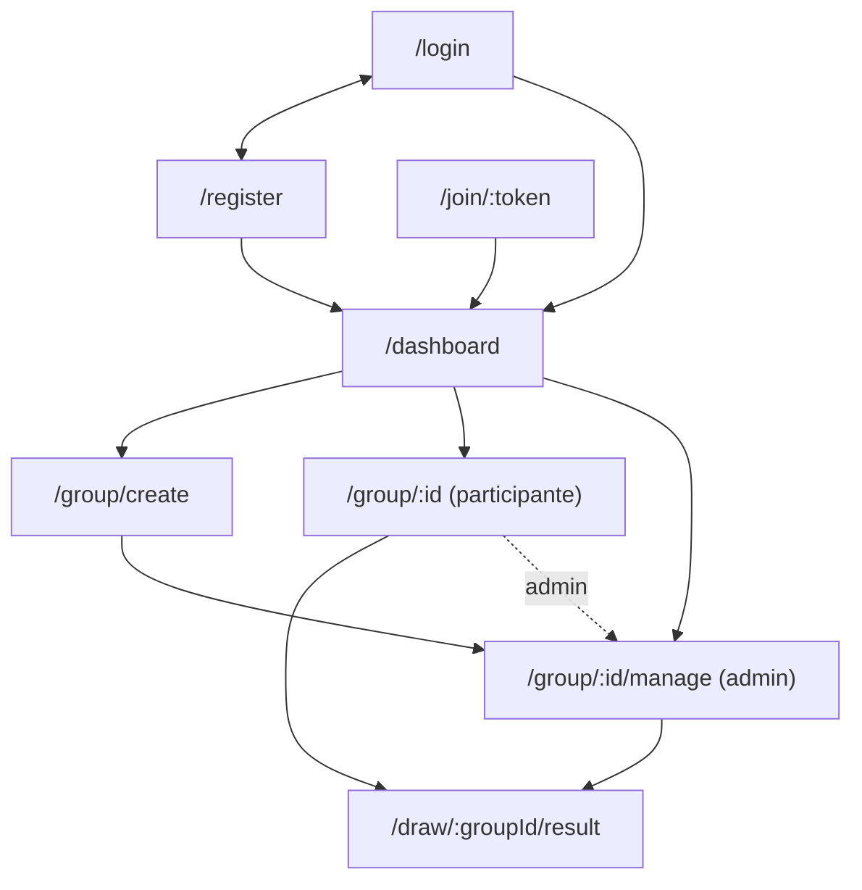

# Roteiro de Protótipo - UTF-Secret (Stitch -> Figma)

Este documento é o insumo para produzir o protótipo navegável exigido pelo RA1-ID1. Ele lista, tela a tela, a
rota, a hierarquia, os **textos literais** que existem no código e um prompt pronto para colar no Stitch.

> **Ordem dos fatos (D-17).** O protótipo é a **fonte** do Design System, não um registro do código. A paleta
> usada hoje no app é **provisória**: verde-pinho `#16452a`, dourado `#e4b750` e fundo claro `#fafafa`. Leve-a ao
> Stitch como ponto de partida, não como camisa de força. Se o protótipo decidir outra coisa, a plan 05-05
> reconcilia os tokens de `src/styles.css` com o que o protótipo definir.

## Como usar este documento

1. Abra o Stitch e crie um projeto novo (mobile).
2. Cole **um bloco de "Prompt sugerido" por vez**, uma tela por vez, começando pelas diretrizes globais abaixo.
3. Ajuste visualmente, mantendo os textos literais indicados (é isso que faz o protótipo casar com o código).
4. Exporte para o Figma, ligue os frames conforme o mapa de navegação e refine.
5. Publique o arquivo com **link público** (qualquer pessoa com o link vê, sem exigir login) e cole o link no
   `README.md`, na seção Links.

## Diretrizes globais

- **Mobile-first**, começando em **320px** de largura. Conteúdo em coluna única com largura máxima de leitura
  confortável (cerca de 28rem no celular). A partir de desktop o container alarga (até cerca de 48rem), sem virar
  uma coluna estreita perdida no meio da tela.
- **Paleta provisória:** primário verde-pinho `#16452a`; acento dourado `#e4b750`; destrutivo vermelho
  (`#e7000b`); fundo claro `#fafafa`; resto neutro (cinzas). Temático sem virar cartão de Natal.
- **Raio de canto** 0.625rem (10px) em cards, botões e campos. **Tipografia** sans-serif de sistema.
- **Toda a copy em português do Brasil**, usando os textos literais deste documento.
- **Alvos de toque de pelo menos 44px** de altura; **foco visível** com anel de 2px.
- Contraste de texto >= 4.5:1 (WCAG 2.1 AA).
- Prever **tema claro e tema escuro** (o app segue a preferência do sistema operacional, sem toggle).

## Mapa de navegação

Conferido contra `src/app/app.routes.ts` e `src/app/features/group/group.routes.ts`.

Notas: toda rota autenticada fica dentro do layout (header, banner de offline, skip link). Quem abre `/join/:token`
sem estar logado passa por `/login` e volta ao convite. Depois de entrar no grupo pelo convite, o app leva ao
`/dashboard`, onde o grupo aparece em "Grupos que participo".

## Telas

### 1. Login

- **Rota:** `/login`
- **Propósito:** autenticar quem já tem conta.
- **Hierarquia:** card centralizado verticalmente -> título -> descrição -> formulário (E-mail, Senha) -> erro da
  API -> botão primário largura total -> link para criar conta.
- **Textos reais:** título "Entrar"; descrição "Acesse sua conta do UTF-Secret."; rótulos "E-mail" e "Senha";
  erros "Informe seu e-mail.", "Informe um e-mail válido.", "Informe sua senha.", "A senha precisa ter pelo menos 6
  caracteres."; botão "Entrar" (enviando: "Entrando..."); rodapé "Não tem conta?" + link "Criar conta".
- **Estados:** vazio; erro de validação por campo (após tocar ou tentar enviar); enviando (botão desabilitado,
  "Entrando..."); erro da API (alerta vermelho abaixo dos campos). O botão fica desabilitado enquanto o formulário
  é inválido.
- **Prompt sugerido para o Stitch:** "Tela de login mobile-first (320px) em português do Brasil para o app
  UTF-Secret, um amigo secreto online. Um card centralizado com o título 'Entrar' e o texto 'Acesse sua conta do
  UTF-Secret.', campos 'E-mail' e 'Senha' com rótulos visíveis, um botão primário verde-pinho (#16452a) de largura
  total com o texto 'Entrar' e, abaixo, 'Não tem conta?' com o link 'Criar conta'. Mostre também a variação com
  mensagens de erro em vermelho. Cantos de 10px, fonte sans-serif, alvos de toque de 44px, tema claro e escuro."

### 2. Cadastro

- **Rota:** `/register`
- **Propósito:** criar uma conta nova.
- **Hierarquia:** card centralizado -> título -> descrição -> formulário (Nome, E-mail, Senha) -> erro da API ->
  botão primário -> link para entrar.
- **Textos reais:** título "Criar conta"; descrição "Participe de um amigo secreto em segundos."; rótulos "Nome",
  "E-mail", "Senha"; erros "Informe seu nome.", "O nome precisa ter pelo menos 2 caracteres.", "Informe uma senha.";
  botão "Criar conta" (enviando: "Criando conta..."); rodapé "Já tem conta?" + link "Entrar".
- **Estados:** vazio; erro de validação; enviando ("Criando conta..."); erro da API.
- **Prompt sugerido para o Stitch:** "Tela de cadastro mobile-first em português do Brasil, no mesmo estilo da tela
  de login do UTF-Secret. Card com título 'Criar conta', subtítulo 'Participe de um amigo secreto em segundos.',
  campos 'Nome', 'E-mail' e 'Senha', botão primário verde-pinho 'Criar conta' e, abaixo, 'Já tem conta?' com o
  link 'Entrar'. Inclua a variação de erro de validação e a variação 'Criando conta...' com o botão
  desabilitado. 320px de largura, alvos de 44px."

### 3. Dashboard

- **Rota:** `/dashboard`
- **Propósito:** ponto de partida do usuário logado: saudação, contagem para o Natal e seus grupos.
- **Hierarquia:** card de saudação -> card de contagem do Natal (carregado sob demanda, veja a tela 4) ->
  cabeçalho "Meus grupos" com botão "Criar grupo" -> seção "Grupos que administro" -> seção "Grupos que participo".
  Cada grupo é um card clicável com nome e status.
- **Textos reais:** "Olá, {nome}!"; "Você está autenticado."; e-mail do usuário; "Meus grupos"; botão "Criar grupo";
  "Grupos que administro"; "Grupos que participo"; status "Aberto", "Sorteando", "Encerrado".
- **Estados:** carregando ("Carregando seus grupos..."); erro (alerta vermelho); vazio de administrados ("Você
  ainda não criou nenhum grupo. Use "Criar grupo" para começar."); vazio de participados ("Você ainda não entrou em
  nenhum grupo. Peça um link de convite ao organizador."); com grupos.
- **Prompt sugerido para o Stitch:** "Dashboard mobile-first em português do Brasil do UTF-Secret. No topo, um card
  'Olá, Ana!' com 'Você está autenticado.' e o e-mail; em seguida um card de contagem para o Natal; depois o título
  'Meus grupos' com um botão primário 'Criar grupo' à direita; duas seções, 'Grupos que administro' e 'Grupos que
  participo', com cards de grupo mostrando o nome e o status (Aberto, Sorteando ou Encerrado). Mostre também os
  estados vazios com os textos 'Você ainda não criou nenhum grupo. Use "Criar grupo" para começar.' e 'Você ainda não
  entrou em nenhum grupo. Peça um link de convite ao organizador.' Paleta verde-pinho e dourado discreto."

### 4. Card de contagem para o Natal

- **Rota:** aparece dentro de `/dashboard` (carregado quando entra na viewport).
- **Propósito:** mostrar quantos dias faltam para o Natal, com dados de uma API pública de feriados.
- **Hierarquia:** card -> título -> descrição -> número grande -> nome e data do feriado.
- **Textos reais:** título "Contagem para o Natal"; descrição "Dados do feriado nacional via BrasilAPI."; número
  como "{n} dias" (singular "1 dia"); linha "{nome do feriado} — 25 de dezembro de {ano}" (nota: o código hoje formata a data com o `DatePipe` sem registrar o locale `pt-BR`, então o mês sai em inglês, "25 de December de {ano}"; o protótipo deve usar o texto correto em português).
- **Estados:** carregando ("Carregando feriados..."; antes disso, um placeholder cinza pulsante); erro ("Não foi
  possível consultar os feriados agora."); sucesso.
- **Prompt sugerido para o Stitch:** "Card compacto de contagem regressiva para o Natal, em português do Brasil, para
  o dashboard do UTF-Secret. Título 'Contagem para o Natal', subtítulo 'Dados do feriado nacional via BrasilAPI.',
  um número grande '71 dias' em destaque e, abaixo, 'Natal — 25 de dezembro de 2026' em cinza. Desenhe também as
  variações 'Carregando feriados...' e 'Não foi possível consultar os feriados agora.' Verde-pinho com um toque
  dourado, sem exagero natalino."

### 5. Criar grupo

- **Rota:** `/group/create`
- **Propósito:** o administrador dá nome ao grupo e recebe o link de convite.
- **Hierarquia:** link "Voltar ao painel" -> **estado A:** card com título, descrição, campo "Nome do grupo", botão;
  **estado B (sucesso):** card com o nome do grupo, mensagem, campo somente leitura com o link, botão "Copiar link" e
  botão "Ir para gerenciar grupo".
- **Textos reais:** "Voltar ao painel"; título "Criar grupo"; descrição "Dê um nome ao seu amigo secreto."; rótulo
  "Nome do grupo"; erros "Informe o nome do grupo." e "O nome precisa ter entre 3 e 60 caracteres."; botão "Criar
  grupo" (enviando: "Criando..."). Sucesso: "Grupo criado! Compartilhe o link de convite abaixo."; rótulo "Link de
  convite"; botões "Copiar link" (depois "Copiado!") e "Ir para gerenciar grupo".
- **Estados:** vazio; erro de validação; enviando; erro da API; **sucesso com link copiável** (e o feedback
  "Copiado!").
- **Prompt sugerido para o Stitch:** "Duas variações de tela mobile em português do Brasil para criar um grupo de
  amigo secreto. Variação 1: card 'Criar grupo' com 'Dê um nome ao seu amigo secreto.', campo 'Nome do grupo' e botão
  primário 'Criar grupo'. Variação 2, de sucesso: card com o nome do grupo, texto 'Grupo criado! Compartilhe o link
  de convite abaixo.', campo somente leitura 'Link de convite' com uma URL, botão primário 'Copiar link' (e a versão
  'Copiado!') e botão secundário 'Ir para gerenciar grupo'. Link 'Voltar ao painel' no topo."

### 6. Entrar em grupo por convite

- **Rota:** `/join/:token`
- **Propósito:** quem recebeu o link confirma a entrada no grupo.
- **Hierarquia:** card -> título "Convite" -> texto com o nome do grupo -> erro -> botão de entrar -> link para o
  painel.
- **Textos reais:** título "Convite"; "Você foi convidado para {nome do grupo}."; botão "Entrar no grupo" (enviando:
  "Entrando..."); link "Ir para o painel". Erros: "Este convite não é válido.", "Este grupo não está mais aceitando
  participantes." (e mensagens de "você já faz parte deste grupo").
- **Estados:** carregando ("Carregando convite..."); convite válido; convite inválido; grupo já sorteado; já é
  membro; entrando.
- **Prompt sugerido para o Stitch:** "Tela mobile em português do Brasil de convite para um amigo secreto. Card com o
  título 'Convite', o texto 'Você foi convidado para Amigo Secreto da Firma.' (nome do grupo em negrito), botão
  primário largura total 'Entrar no grupo' e link discreto 'Ir para o painel'. Desenhe as variações 'Carregando
  convite...', 'Este convite não é válido.' e 'Este grupo não está mais aceitando participantes.' em vermelho."

### 7. Grupo (visão do participante)

- **Rota:** `/group/:id`
- **Propósito:** o participante vê o grupo, os colegas e edita a própria lista de desejos.
- **Hierarquia:** link "Voltar ao painel" -> card do grupo (nome, status, botões) -> card "Participantes" (nomes, sem
  ações) -> card "Minha lista de desejos" (rótulo, área de texto, botão salvar).
- **Textos reais:** status "Status: aberto para novos participantes.", "Status: sorteio em andamento.", "Status:
  fechado."; botão "Ver meu amigo secreto" (só quando o sorteio foi feito); botão "Gerenciar grupo" (só para o
  admin); "Participantes"; "Carregando participantes..."; "Nenhum participante ainda."; "Minha lista de desejos";
  rótulo "O que você gostaria de receber"; placeholder "Escreva o que você gostaria de receber (opcional)."; botão
  "Salvar lista" (salvando: "Salvando...", depois "Salvo!").
- **Estados:** carregando; vazio; grupo aberto; grupo sorteado (aparece "Ver meu amigo secreto"); erro; lista salva.
- **Prompt sugerido para o Stitch:** "Tela mobile em português do Brasil do grupo de amigo secreto 'Amigo Secreto da
  Firma', visão do participante. Um card com o nome, 'Status: aberto para novos participantes.' e, na variação
  pós-sorteio, o botão primário 'Ver meu amigo secreto'. Um card 'Participantes' com uma lista de nomes, e um card
  'Minha lista de desejos' com rótulo 'O que você gostaria de receber', área de texto com placeholder 'Escreva o que
  você gostaria de receber (opcional).' e botão 'Salvar lista' (variação 'Salvo!')."

### 8. Gerenciar grupo (visão do administrador)

- **Rota:** `/group/:id/manage`
- **Propósito:** o admin compartilha o convite, gerencia participantes e realiza o sorteio. **Ele nunca vê os
  pares.**
- **Hierarquia:** card do grupo (nome, status, link de convite com "Copiar link", área do sorteio) -> card
  "Participantes" com linhas e botão "Remover" -> card "Minha lista de desejos" (se o admin também participa).
- **Textos reais:** rótulo "Link de convite"; "Copiar link" / "Copiado!"; "Faltam {n} participante(s) para sortear
  (mínimo 3)."; botão "Realizar sorteio"; confirmação "Tem certeza? Esta ação é irreversível." com botões "Sim,
  sortear" (enviando: "Sorteando...") e "Não"; remoção: botão "Remover", confirmação "Remover?" com "Sim" e "Não";
  "Ver meu amigo secreto" após o sorteio; "Nenhum participante ainda.".
- **Estados:** poucos participantes (botão "Realizar sorteio" desabilitado e aviso de quantos faltam); pronto para
  sortear; **confirmação do sorteio**; sorteando; grupo encerrado; confirmação de remoção; erro.
- **Prompt sugerido para o Stitch:** "Tela mobile em português do Brasil para o administrador de um amigo secreto.
  Card do grupo com status, campo somente leitura 'Link de convite' e botão 'Copiar link'. Abaixo, a área de
  sorteio com três variações: aviso 'Faltam 2 participantes para sortear (mínimo 3).' com o botão 'Realizar sorteio'
  desabilitado; botão habilitado; e a confirmação 'Tem certeza? Esta ação é irreversível.' com o botão vermelho 'Sim,
  sortear' e o botão 'Não'. Depois, o card 'Participantes' com linhas de nome e botão 'Remover' (variação 'Remover?
  Sim / Não'). Deixe claro visualmente que o admin não vê os pares."

### 9. Resultado do sorteio

- **Rota:** `/draw/:groupId/result`
- **Propósito:** o participante descobre, de forma deliberada, quem tirou.
- **Hierarquia:** **antes da revelação:** um grande botão/cartão fechado ocupando a largura; **depois:** card com
  "Você tirou {nome}", descrição e a lista de desejos da pessoa; botão de voltar nos estados de exceção.
- **Textos reais:** antes: "Revelar meu amigo secreto". Depois: "Você tirou {nome}", "Aqui está a lista de desejos
  dessa pessoa.", a lista ou "Esta pessoa ainda não cadastrou uma lista de desejos.". Exceções: "O sorteio deste
  grupo ainda não aconteceu." e "Não encontramos seu resultado. Tente novamente mais tarde." com o botão "Voltar para
  o grupo". (Existe também um título "Meu amigo secreto" visível apenas para leitores de tela.)
- **Estados:** **antes da revelação** (cartão fechado, só aparece o conteúdo depois do toque); **depois da
  revelação**; carregando (placeholder pulsante); sorteio ainda não realizado; resultado não encontrado.
- **Prompt sugerido para o Stitch:** "Tela mobile em português do Brasil de revelação de amigo secreto, em duas
  versões. Antes: um cartão fechado, alto e largo, verde-pinho, com o texto 'Revelar meu amigo secreto' como único
  elemento, convidando ao toque. Depois: um card com o título 'Você tirou Marina', o texto 'Aqui está a lista de
  desejos dessa pessoa.' e a lista de desejos. Inclua uma variação para 'O sorteio deste grupo ainda não aconteceu.'
  com o botão 'Voltar para o grupo'. Clima de surpresa, discreto, com um toque de dourado."

### 10. Layout autenticado (casca do app)

- **Rota:** envolve todas as telas autenticadas (`/dashboard`, `/group/...`, `/join/:token`, `/draw/...`).
- **Propósito:** moldura comum: marca, usuário, saída, aviso de conexão e acesso rápido ao conteúdo.
- **Hierarquia:** skip link (visível só ao receber foco) -> banner de offline (somente sem conexão) -> header com o
  nome do produto à esquerda, nome do usuário e botão "Sair" à direita -> área principal.
- **Textos reais:** skip link "Pular para o conteúdo"; banner "Você está offline. Algumas ações podem falhar.";
  marca "UTF-Secret"; nome do usuário (truncado); botão "Sair" (saindo: "Saindo...").
- **Estados:** online; **offline** (banner escuro fixo no topo); skip link focado; saindo.
- **Prompt sugerido para o Stitch:** "Moldura de aplicativo mobile em português do Brasil para o UTF-Secret: header
  com 'UTF-Secret' em negrito à esquerda e, à direita, o nome do usuário em cinza (truncado) e um botão
  contornado 'Sair'. Variação offline: uma faixa escura no topo com o texto 'Você está offline. Algumas ações podem
  falhar.' Variação de foco por teclado: um link 'Pular para o conteúdo' visível no canto superior esquerdo com anel
  de foco. Em desktop, o conteúdo se alarga e fica centralizado."

## Checklist de entrega do protótipo

Antes de colar o link no README, confirme:

- [ ] As 10 telas acima estão presentes (login, cadastro, dashboard, contagem do Natal, criar grupo, convite, grupo
      do participante, gerenciar grupo, resultado e layout autenticado).
- [ ] A navegação entre os frames é clicável, seguindo o mapa de navegação.
- [ ] O arquivo está publicado com **link público**, que abre sem login.
- [ ] Os textos são os literais deste documento, em português do Brasil.
- [ ] Os dois temas (claro e escuro) estão presentes, ou a escolha de entregar só o claro está declarada.
- [ ] Os alvos de toque têm pelo menos 44px e o layout funciona a partir de 320px.
- [ ] Se a paleta mudou em relação à provisória, avisar para a plan 05-05 reconciliar os tokens.
